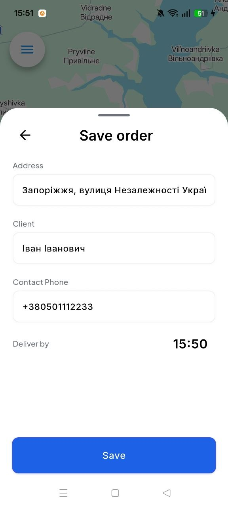
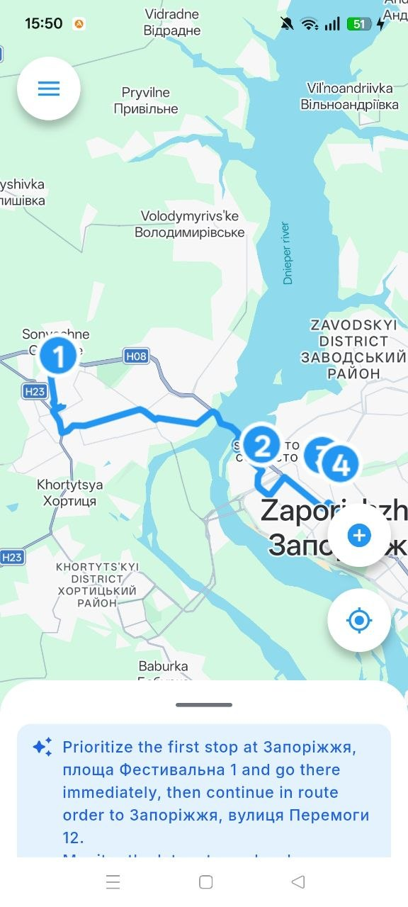
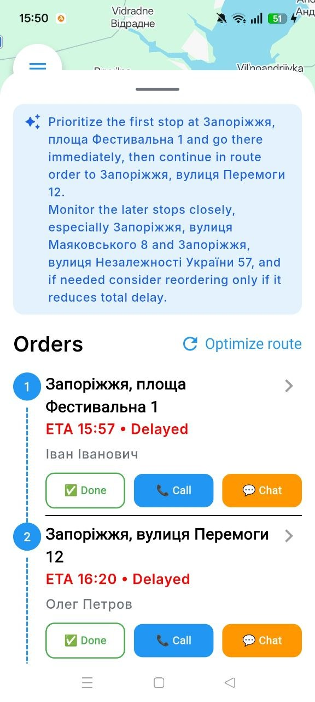
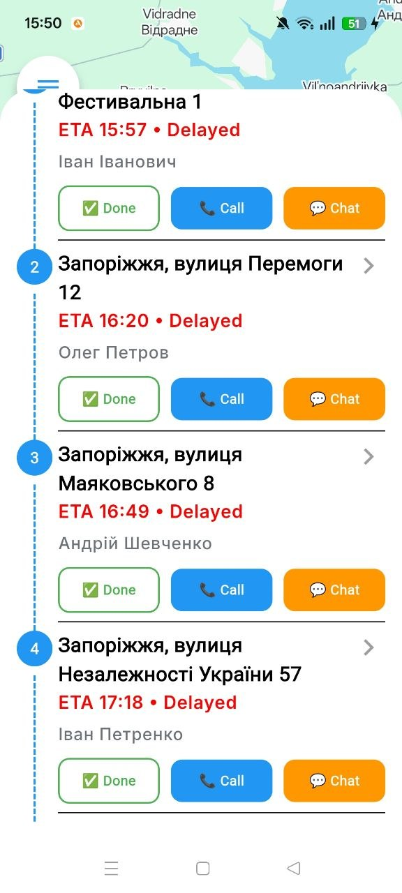
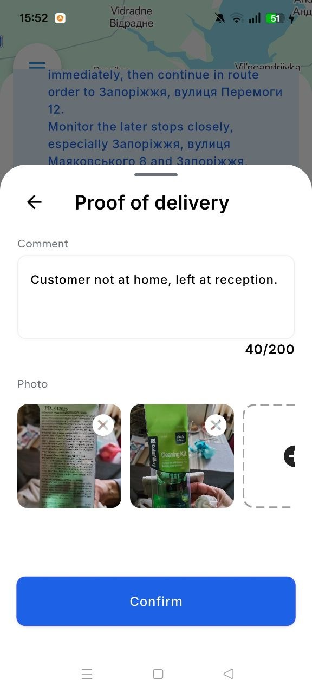

<div align="center">

# 🚚 Smart Courier Assistant

**Mobile application for courier delivery management with routes, ETA and proof of delivery**

</div>

## 📄 About

Smart Courier Assistant is a mobile application designed to help couriers manage daily deliveries more efficiently and predictably.
The app provides tools for order management, route visualization, ETA tracking, and delivery confirmation, allowing couriers to reduce delays, minimize errors, and make better decisions during delivery execution.
Key capabilities include real-time route maps, ETA risk indication, route optimization, proof of delivery (photo and notes), and personalized route recommendations by using AI when delivery delays are likely.

## ✨ Features

- 🔐 **Authentication & Profile** – Courier registration, login, profile management (name, phone, avatar)  
- 📦 **Order Management** – Add/edit/delete orders, track delivery statuses (In Transit, Delivered), contact clients via calls or messengers  
- 📍 **Routes & ETA** – Delivery route map, route optimization via routing API, ETA with color indicators: 🟢 on time, 🟡 at risk, 🔴 delayed  
- 📜 **Route History & Recommendations** – View past routes, get personalized route recommendations in case of ETA risk by AI  
- 📸 **Proof of Delivery (POD)** – Capture delivery confirmation via photo of the order and note  
- 🎨 **UI/UX** – Light/dark theme, multi-language support

## 🛠 Tech Stack

**Core Framework**
- **Flutter** – Cross-platform UI framework  
- **Dart** – Programming language  
- **flutter_dotenv** – Environment variables  

**State Management**
- **BLoC**
- **Cubit**

**Dependency Injection**
- **GetIt** – Service locator and dependency injection

**Backend & Cloud Services**
- **Firebase**
  - **Firebase Auth** – User authentication
  - **Cloud Firestore** – Real-time NoSQL database
- **Google Sign-In** – OAuth authentication
- **Supabase** – File storage for photos and user's avatar

**Navigation**
- **AutoRoute** – Navigation and routing

**Maps & Geolocation**
- **Google Maps Flutter** – Interactive maps
- **Geolocator** – Location services
- **Geocoding** – Address <-> coordinates conversion
- **Permission Handler** – Permission management

**UI Components**
- **Another Flutter Splash Screen** – Custom splash screen

**Media & Storage**
- **Image Picker** – Image selection from gallery
- **Shared Preferences** – Local data persistence

**Utilities**
- **UUID** – Unique ID generation
- **HTTP** – Networking
- **PDF & Printing** – PDF generation and printing

## 🚀 Getting Started

### Prerequisites
- Flutter SDK (>= 3.x)
- Dart
- Android Studio or VS Code
- Android emulator or physical Android device

### Installation
1. Clone the repository
```
git clone https://github.com/yozhykovanatolii/SmartCourierAssistant.git
```

2. Install dependencies
```
flutter pub get
```

3. Configure environment variables  

This project uses external services to provide routing and AI-assisted features, as well as file storage.

- **OpenRouteService** — route calculation and ETA estimation
- **OpenAI API** — AI-assisted route recommendations
- **Supabase Storage** — file storage for user uploads and media management

To configure these services:
- Create an account at https://openrouteservice.org and generate an API key
- Create an account at https://platform.openai.com and generate an API key
- Create a project in Supabase at https://supabase.com and get your project credentials(URL and anon key)
- Open the `.env` file in the project root and set the following values:

```
SUPABASE_PROJECT_URL=your_supabase_project_url
SUPABASE_PROJECT_KEY=your_supabase_project_key
OPENAI_API_KEY=your_openai_api_key
OPENROUTE_API_KEY=your_openrouteservice_api_key
```

4. Run the application
```
flutter run
```

## 📸 Screenshots
<details>
<summary>📦 <strong>Order Management</strong></summary>
<div align="center">

<br>
CRUD Orders: Add / Edit / Delete
</div>
</details>

<details>
<summary>📍 <strong>Routes & ETA</strong></summary>
<div align="center">

<br>
Route Map with Markers
</div>
</details>

<details>
<summary>🧠 <strong>Personalized Recommendations</strong></summary>
<div align="center">

<br>
AI-based Route Recommendation • Partially shows related orders
</div>
</details>

<details>
<summary>📦 <strong>Additional Orders</strong></summary>
<div align="center">

<br>
Orders not included in Recommendations view
</div>
</details>

<details>
<summary>📸 <strong>Proof of Delivery (POD)</strong></summary>
<div align="center">

<br>
Photo confirmation and note field
</div>
</details>
